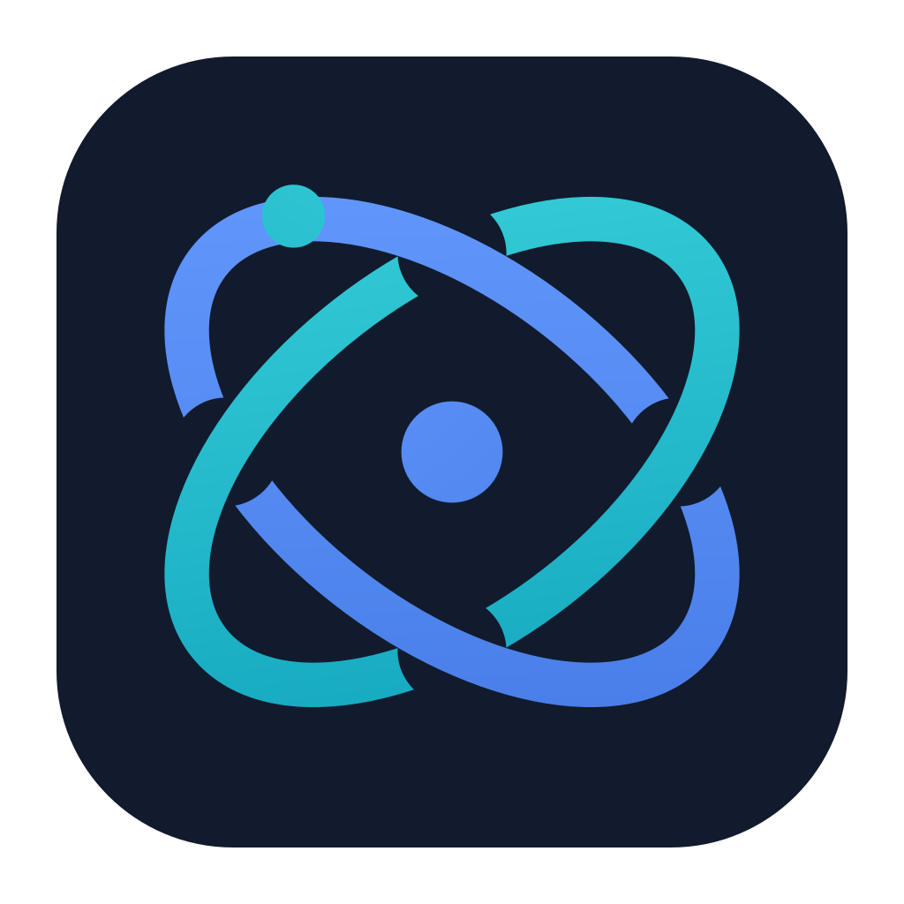

<p align="center">
  
</p>

# Agent Monitor

A native macOS app for AI agent activity and local system monitoring. A floating HUD keeps agent usage and your Mac's status in view.

**English** · [繁體中文](README.zh-TW.md) · [简体中文](README.zh-CN.md)

[Download the latest release](https://github.com/Lotus-030226/AgentMonitor/releases/latest) · [Version 1.1.0 for Apple Silicon](https://github.com/Lotus-030226/AgentMonitor/releases/download/v1.1.0/AgentMonitor-1.1.0-macOS-arm64.zip)

## Features

- **Agent activity:** View supported clients' quota, token usage, conversation state, and CLI or Desktop conversation sources. These include Claude Code and Codex. Availability depends on each client and account.
- **Running conversations:** Conversation lists show active work, including pending approvals. Completed conversations stay in local history.
- **Floating HUD:** View two agents at a time and scroll for more. The local summary adapts to the HUD width, with up to four columns. Hover over Docker for container names, images, and status.
- **Overview:** Paired cards have equal widths and heights, with aligned headers and chart footers.
- **System status:** Track CPU, memory pressure, storage, network traffic, battery, and thermal state. View processes with high resource use.
- **Six pages:** Open Overview, Processes, Docker, Local Services, Tokens, and Sessions in one window.
- **Local services:** View TCP listeners, including services outside Docker. Search, pause, or refresh the list. Sampling runs every 10 seconds. Choose HTTP or HTTPS to open a service; the app does not probe websites automatically.
- **Optional client hooks:** Handle supported approval requests through the HUD. Each request needs an explicit one-time approval or refusal.

## Install

Requires **macOS 14 or later**. The current download supports **Apple Silicon (arm64)**.

1. Download `AgentMonitor-1.1.0-macOS-arm64.zip` from the release page.
2. Extract the ZIP and drag **Agent Monitor.app** to **Applications**.
3. Open the app from Applications.

The app uses ad-hoc signing. It has no Developer ID certificate or Apple notarization. If macOS blocks it, review the download source. Then use **System Settings → Privacy & Security → Open Anyway** if you trust it.

## Use

Open the floating HUD for agent details and the local summary. Click a summary item to open its detail page. The app has no menu bar icon. Reopen the app to restore the main window.

| Shortcut | Action |
| --- | --- |
| `⌘1` | Open Overview |
| `⌘,` | Open Settings |
| `⌘⌥H` | Show or hide the main HUD |
| `⌘Q` | Quit |

Sign in through each provider's installed client. Agent Monitor uses existing local accounts; it has no separate account or credential-entry screen. For Claude Code, run `claude auth login`, check `claude auth status`, then refresh in Agent Monitor Settings. Conversation activity can appear even when quota is unavailable.

Client hooks and launch at login are off on first launch. Enable hooks under **Settings → General → Client hooks** when needed. Hook support varies by client.

Local monitoring reads system state. It does not control services or containers. Agent providers can use existing client credentials to query remote usage. See [data access](docs/data-access.md) for sources, requests, and storage. Unavailable readings show an unknown or unavailable state.

## Updates

Choose **Agent Monitor → Check for Updates…** or use **Settings → General** to check manually. Automatic checks are enabled by default. The app checks at startup, at most once every 24 hours. Turn automatic checks off in General if needed.

A newer stable release appears in Settings and the expanded HUD. Open its release page or download its ZIP when ready. Downloads start only after your click. The app does not install updates or replace itself.

To update, quit Agent Monitor, extract the new ZIP, and replace **Agent Monitor.app** in Applications. Your preferences stay in place.

Checks use the official GitHub API for this repository. They use no provider credentials, cookies, or authentication. GitHub receives normal network information, including your IP address and client headers. No conversation content or system readings are sent. See [update data access](docs/data-access.md#update-checks).

## Build from source

Use macOS 14 or later and Xcode with Swift 6 support. Run these commands from the repository folder:

```sh
scripts/build-app.sh release
open "build/Agent Monitor.app"
```

The script builds the app bundle, includes resources and license notices, and applies ad-hoc signing. It selects an installed Xcode for that process without changing the system selection.

## License and credits

Based on [Agent HUD Open](https://github.com/jazzenchen/agent-hud-native-open). See [upstream details](docs/UPSTREAM.md).

This is a modified distribution maintained by Lotus. Project code and the original Agent Monitor logo use the [Apache License 2.0](LICENSE). [NOTICE](NOTICE) retains project and upstream attribution. Third-party assets have their own notices and terms in [THIRD_PARTY_NOTICES.txt](THIRD_PARTY_NOTICES.txt). Product names and third-party logos belong to their respective owners.
